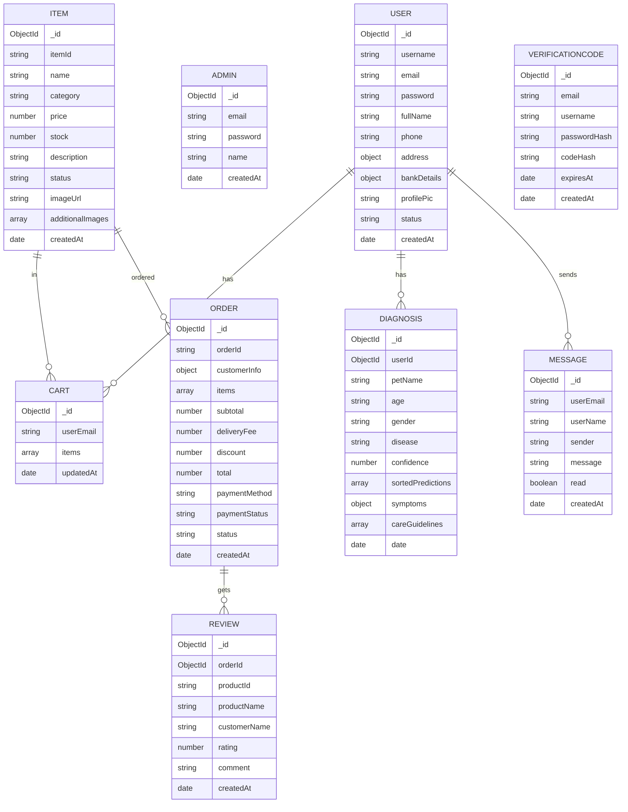

# DoggoCare — MongoDB Collections (Database Tables)

> **Database:** `petzone` | **Total Collections:** 9

---

## 📋 Collections Overview



---

## 🗄️ සෑම Collection එකේ Details

### 1. 👤 `users` — Registered Customers
| Field | Type | Details |
|-------|------|---------|
| `_id` | ObjectId | Auto generated |
| `username` | String | Unique |
| `email` | String | Unique, login ID |
| `password` | String | Hashed (bcrypt) |
| `fullName` | String | Display name |
| `phone` | String | Contact |
| `address` | Object | street, city, postalCode, province |
| `bankDetails` | Object | accountHolder, bankName, branch, accountNumber |
| `profilePic` | String | Image URL |
| `status` | String | Active / Inactive |

---

### 2. 🛡️ `admins` — Admin Accounts
| Field | Type | Details |
|-------|------|---------|
| `email` | String | Unique |
| `password` | String | Hashed |
| `name` | String | Default: "Admin" |

---

### 3. 📦 `items` — Pet Shop Products
| Field | Type | Details |
|-------|------|---------|
| `itemId` | String | Auto: `ITM_001`, `ITM_002`... |
| `name` | String | Product name |
| `category` | String | Default: "General" |
| `price` | Number | **Rs. amount** |
| `stock` | Number | Quantity available |
| `description` | String | Product details |
| `status` | Enum | `Available` / `Low Stock` / `Out of Stock` |
| `imageUrl` | String | Main image |
| `additionalImages` | Array | Extra images |

---

### 4. 🛒 `carts` — Shopping Carts (1 per user)
| Field | Type | Details |
|-------|------|---------|
| `userEmail` | String | Unique - links to User |
| `items` | Array | CartItem list |
| `items[].productId` | String | Links to Item |
| `items[].name` | String | Product name |
| `items[].price` | Number | Rs. price |
| `items[].quantity` | Number | How many |
| `items[].image` | String | Image URL |

---

### 5. 📋 `orders` — Placed Orders
| Field | Type | Details |
|-------|------|---------|
| `orderId` | String | Auto: `ORD_001`, `ORD_002`... |
| `customerInfo` | Object | firstName, lastName, email, phone, address, city, postalCode, province |
| `items` | Array | Ordered products |
| `subtotal` | Number | Items total |
| `deliveryFee` | Number | Rs. 350 |
| `total` | Number | subtotal + delivery |
| `paymentMethod` | String | `cod` / `stripe` |
| `paymentStatus` | Enum | `Pending` / `Paid` / `Failed` |
| `status` | Enum | `Pending` → `Processing` → `Shipped` → `Delivered` / `Cancelled` |

---

### 6. 🔬 `diagnoses` — Dog Skin Detection Results
| Field | Type | Details |
|-------|------|---------|
| `userId` | ObjectId | Links to User (optional) |
| `petName` | String | Dog's name |
| `age` | String | Dog's age |
| `gender` | String | Male / Female |
| `disease` | String | Detected disease name |
| `confidence` | Number | ML model confidence (0-1) |
| `sortedPredictions` | Array | Top predictions list |
| `symptoms` | Object | Symptom answers |
| `careGuidelines` | Array | Care tips |

---

### 7. ⭐ `reviews` — Product Reviews
| Field | Type | Details |
|-------|------|---------|
| `orderId` | ObjectId | Links to Order |
| `productId` | String | Links to Item |
| `productName` | String | Product name |
| `customerName` | String | Reviewer name |
| `rating` | Number | 1 to 5 stars |
| `comment` | String | Review text |

---

### 8. 💬 `messages` — User ↔ Admin Chat
| Field | Type | Details |
|-------|------|---------|
| `userEmail` | String | Which user |
| `userName` | String | Display name |
| `sender` | Enum | `user` / `admin` |
| `message` | String | Message content |
| `read` | Boolean | Seen or not |

---

### 9. 📧 `verificationcodes` — Email OTP (Auto-delete)
| Field | Type | Details |
|-------|------|---------|
| `email` | String | Unique |
| `username` | String | For registration |
| `passwordHash` | String | Pending password |
| `codeHash` | String | OTP hash |
| `expiresAt` | Date | **Auto-delete** after expiry (TTL index) |

> [!NOTE]
> `VerificationCode` records are automatically deleted by MongoDB after `expiresAt` — no manual cleanup needed.

---

## 🔗 Relationships Summary

```
User ──────── Cart        (1 user = 1 cart)
User ──────── Diagnosis   (1 user = many diagnoses)
User ──────── Message     (many messages per user)
Item ──────── Cart        (items appear in carts)
Item ──────── Order       (items appear in orders)
Order ─────── Review      (1 order can get a review)
```
